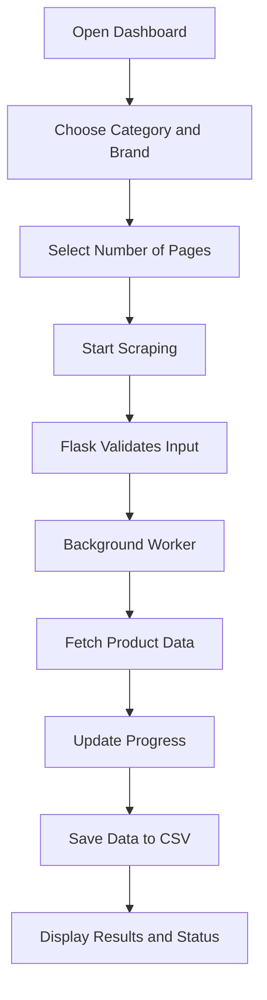

# 🕷️ Scrapezilla

<p align="center">
  <strong>A Digikala Product Scraper & Interactive Flask Dashboard</strong>
  <br>
  Collect product data, monitor scraping progress, and export results to CSV.
</p>

<p align="center">
  
  
  
  
  <br>
  
  <a href="https://github.com/asalbaharlouie/Scrapezilla/actions/workflows/tests.yml">
    
  </a>
</p>

---

## 📌 Overview

**Scrapezilla** is a Python-based web scraping project that collects product information from Digikala and presents the process through an interactive Flask dashboard.

Instead of running a scraper only in the terminal, Scrapezilla provides a web interface where users can select a product category, enter a brand, start a scraping job, monitor its progress, and access collected product information.

The project combines web scraping, background task execution, CSV data export, automated testing, and continuous integration in one application.

## ✨ Features

- 🛍️ **Product Scraping** — Collect product information from Digikala.
- 🎛️ **Interactive Dashboard** — Control scraping jobs through a web interface.
- 📂 **Category Selection** — Choose from supported product categories.
- 🏷️ **Brand Filtering** — Specify the brand you want to collect products for.
- 📊 **Live Progress Tracking** — Monitor the current status, page progress, and product count.
- ⚡ **Background Execution** — Run scraping jobs without keeping the start request open.
- 📄 **CSV Export** — Save collected data for further analysis.
- 🧪 **Automated Testing** — Test application routes, input validation, CSV handling, and scraper behavior.
- 🔄 **GitHub Actions** — Automatically run tests when code is pushed or a pull request is opened.
- 🌙 **Dark Dashboard UI** — A modern interface with a dark theme and neon-blue accents.

## 🖥️ How It Works

Scrapezilla follows a simple workflow:



### Step-by-step

1. **Configure the scraper:** Open the dashboard, choose a product category, enter a brand, and select the number of pages.
2. **Start a job:** The frontend sends a request to the Flask application.
3. **Validate the request:** The backend checks the selected options and rejects invalid input.
4. **Collect product data:** A background thread runs the scraping function and requests product data from Digikala.
5. **Track progress:** The scraper reports progress, and the dashboard retrieves the current job status.
6. **Save results:** Collected product data is saved to a CSV file according to the scraper configuration.
7. **Review the output:** The dashboard displays job information and a selection of collected products.

## 🧰 Tech Stack

| Technology | Purpose |
|---|---|
| Python | Core programming language |
| Flask | Web application and API endpoints |
| Requests | HTTP requests to retrieve product data |
| Pandas | CSV and tabular data handling |
| HTML | Dashboard structure |
| CSS | Styling and responsive layout |
| JavaScript | Dashboard interactions and status polling |
| Pytest | Automated testing |
| pytest-cov | Test coverage reports |
| GitHub Actions | Continuous integration |
| uv | Optional Python package and environment management |

## 📁 Project Structure

```text
Scrapezilla/
├── app.py
├── digiscraper.py
├── requirements.txt
├── pytest.ini
├── digikala_products.csv
├── templates/
│   └── index.html
├── static/
│   ├── style.css
│   └── script.js
├── tests/
│   ├── conftest.py
│   ├── test_app.py
│   ├── test_concurrency.py
│   ├── test_csv.py
│   └── test_scraper.py
├── .github/
│   └── workflows/
│       └── tests.yml
├── .gitignore
├── LICENSE
└── README.md
```

## 🚀 Getting Started

Follow these steps to run Scrapezilla locally.

### Prerequisites

- Python 3.12 or a compatible version supported by the project dependencies.
- Git.
- pip, or optionally uv.
- An internet connection for live scraping.

### 1. Clone the repository

```bash
git clone https://github.com/asalbaharlouie/Scrapezilla.git
cd Scrapezilla
```

### 2. Create a virtual environment

**Linux / macOS**

```bash
python3 -m venv .venv
source .venv/bin/activate
```

**Windows PowerShell**

```powershell
py -m venv .venv
.venv\Scripts\Activate.ps1
```

### 3. Install dependencies

Upgrade pip and install the required packages:

```bash
python -m pip install --upgrade pip
pip install -r requirements.txt
```

**Optional: use uv**

If you prefer `uv`, create and activate a virtual environment, then install the requirements:

```bash
uv venv
uv pip install -r requirements.txt
```

> The current setup uses `requirements.txt`. The commands above do not require a `pyproject.toml` file.

### 4. Start the application

Run the Flask application:

```bash
python app.py
```

Open the following address in your browser:

**http://127.0.0.1:5000**

You should now be able to interact with the Scrapezilla dashboard.

## 🎮 Using the Dashboard

1. Open the application in your browser.
2. Select a supported product category.
3. Enter a brand name, such as `samsung`.
4. Choose a page count between 1 and 10.
5. Select the available scraping method.
6. Click the start button.
7. Monitor progress and review the job status and product count.

Available categories depend on the options configured in the frontend and scraper.

## 🔌 API Reference

Scrapezilla exposes the following Flask endpoints:

| Method | Endpoint | Description |
|---|---|---|
| `GET` | `/` | Renders the dashboard |
| `POST` | `/api/start` | Validates settings and starts a scraping job |
| `GET` | `/api/status` | Returns the current job status |

### Start a scraping job

**Endpoint:** `POST /api/start`

Example JSON payload:

```json
{
  "method": "threading",
  "pages": 3,
  "category": "mobile-phone",
  "brand": "samsung"
}
```

Example successful response:

```json
{
  "message": "Scraping started."
}
```

The endpoint validates the request before starting a background worker. An invalid request returns an error response, while an attempt to start another job during an active job returns HTTP `409 Conflict`.

### Check scraping status

**Endpoint:** `GET /api/status`

The response contains fields such as:

- `running` — Whether a job is currently running.
- `status` — Current job status.
- `progress` — Number of pages processed.
- `total_pages` — Number of requested pages.
- `products_count` — Number of collected products.
- `elapsed` — Execution time, when available.
- `error` — Error details, if a job fails.
- `results` — A selection of collected products.

## 📄 Output Data

Scraped product information is exported to CSV according to the output filename configured in the scraper.

Depending on the product data returned by Digikala, the dataset may include:

| Field | Description |
|---|---|
| `id` | Product identifier |
| `title_fa` | Persian product title |
| `title_en` | English product title |
| `price_rial` | Price in rials |
| `price_toman` | Price in tomans |
| `discount_percent` | Discount percentage |
| `rating_rate` | Product rating |
| `seller` | Seller information |
| `warranty` | Warranty information |
| `color` | Product color |
| `url` | Product page URL |
| `scraped_at` | Collection timestamp |

The exact fields depend on the data available from the source.

## 🧪 Testing

Scrapezilla uses pytest to test the application and scraper components.

Run the complete test suite:

```bash
python -m pytest -v
```

Run tests with a coverage report:

```bash
python -m pytest -v --cov=. --cov-report=term-missing
```

The test suite covers application routes, invalid inputs, job concurrency, CSV behavior, and scraper functionality.

Where possible, network requests should be mocked during tests so that automated testing does not depend on live responses from Digikala.

## 🔄 Continuous Integration

GitHub Actions runs the project's automated tests on pushes and pull requests.

Workflow file:

```text
.github/workflows/tests.yml
```

To check a workflow run:

1. Open the [Scrapezilla repository](https://github.com/asalbaharlouie/Scrapezilla).
2. Select the **Actions** tab.
3. Open the latest workflow run.
4. Review the installation and test steps.

A successful workflow indicates that the configured checks passed for that run.

## 🛠️ Troubleshooting

### `ModuleNotFoundError`

Make sure your virtual environment is activated and install dependencies:

```bash
python -m pip install -r requirements.txt
```

### The dashboard does not open

Confirm that the Flask application is running and check the terminal for errors. The default local address is `http://127.0.0.1:5000`.

### Scraping fails or returns no products

The source website may be temporarily unavailable, may change its API, or may reject requests. Check the job status and error message before retrying.

### GitHub Actions cannot import a dependency

Make sure the dependency is listed in `requirements.txt` and that the workflow installs dependencies before running tests.

## ⚠️ Responsible Use

- Respect Digikala's applicable terms, access restrictions, and policies.
- Avoid excessive requests and unnecessary load on the source website.
- Network responses and product availability may change over time.
- Do not commit credentials, secrets, virtual environments, or sensitive data.
- Use mocked responses for automated tests whenever possible.

## 🗺️ Roadmap

Potential future improvements include:

- [ ] Add product search and additional filters.
- [ ] Improve progress reporting and error recovery.
- [ ] Add product price comparisons and visualizations.
- [ ] Provide a dashboard option to download CSV results.
- [ ] Expand automated test coverage.
- [ ] Improve support for different scraping strategies.
- [ ] Add clearer logging and configuration options.

## 🤝 Contributing

Contributions, bug reports, and suggestions are welcome.

1. Fork the repository.
2. Create a feature branch.
3. Make your changes.
4. Run the test suite.
5. Open a pull request describing your changes.

## 📜 License

This project is licensed under the **MIT License**.

---

<p align="center">
  Built with 🐍 Python and 💙 curiosity.
  <br>
  <strong>Scrapezilla</strong> — collect, monitor, and analyze product data.
</p>
